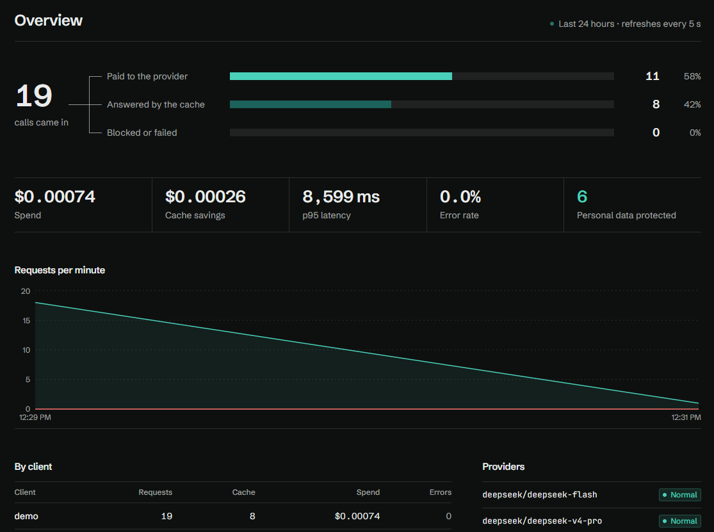

# Comporta

An LLM gateway written in Go. It sits between a company's applications and AI providers (DeepSeek or any
OpenAI-compatible API) and handles what usually gets out of control: who is using it, how much it costs,
the same question paid for twice, the provider that goes down, and personal data leaking out of the country.

New here? Start with the **[project overview](docs/OVERVIEW.md)**: the problem, how a request flows, how the
personal-data masking works, the measured numbers and the main design decisions.



## Live demo

A public instance runs on Render (free tier) with the **fake provider**: nothing reaches a real AI, so there
is no cost and no real data.

1. Open **[comporta.onrender.com](https://comporta.onrender.com)** and sign in with the token **`demo-comporta`**.
2. Go to **Playground**, paste the key **`ck_demo_comporta`** and send something like
   `meu CPF é 529.982.247-25 e o e-mail ana@exemplo.com` ("my CPF is ... and my email is ...").
3. The **What the provider received** card shows `[CPF_1]` and `[EMAIL_1]`; **What came back to you** has the
   original data. The **Overview** shows the request, the estimated cost and the masked personal data.

Through the API, with any OpenAI-compatible SDK:

```bash
curl https://comporta.onrender.com/v1/chat/completions -H "Authorization: Bearer ck_demo_comporta" \
  -d '{"model":"rapido","messages":[{"role":"user","content":"meu CPF é 529.982.247-25"}]}'
```

Demo limits: it sleeps after 15 min without traffic (the first visit takes ~1 min), runs on 0.1 CPU (the
numbers below were measured locally), and the disk is wiped on every restart, which recreates the demo client.
The admin token and the key are public on purpose: the instance is disposable and **never receives the
`DEEPSEEK_API_KEY`** (see `render.yaml`).

## What it does

- **One key per application** (`ck_...`). The real provider key stays on the server. The database stores only the SHA-256.
- **Per-client limits and budget:** requests per minute (429 + `Retry-After`) and monthly spend in US$ (402).
- **LGPD (Brazil's data protection law):** CPF and CNPJ (Brazilian taxpayer IDs, with check-digit validation), cards (Luhn), email and Brazilian phone numbers are replaced with placeholders before leaving (`my CPF is [CPF_1]`) and restored in the response, **including when streaming**.
- **Opt-in exact cache + singleflight:** identical concurrent requests become a single paid call.
- **Resilience:** per-model semaphore, retry with backoff and jitter (honoring `Retry-After`), a circuit breaker per destination and fallback to the next model, all before the first byte.
- **SSE streaming** relayed token by token, with a watchdog (keep-alives don't count as progress) and cancellation of the paid call when the client disconnects.
- **Shadow mode:** sends the same question to a second model in the background and compares latency, cost and size. It lets you migrate models without risk.
- **Usage and cost** per client and per model (micro-dollars, with DeepSeek's off-peak pricing), written to SQLite in batches.
- **React dashboard** embedded in the binary: throughput, spend, cache savings, p95, protected data, clients, keys, shadow and a playground.

## Numbers

k6 at 1,000 req/s for 30 s, gateway and k6 on the same Docker network, fake provider with a fixed 60 ms and LGPD masking on:

| Scenario | Throughput | p50 | p95 | p99 | Success |
|---|---|---|---|---|---|
| No cache | 991 req/s | 60.8 ms | 61.7 ms | 64.7 ms | 100% |
| Cache (20 repeated questions) | 999 req/s | 0.39 ms | 0.58 ms | 0.79 ms | 100%, **99.9% of paid calls avoided** |
| Chaos (provider failing 50% with 503) | 961 req/s | 63.9 ms | 649 ms | 977 ms | **98.4%** |

- **Gateway overhead:** ~0.8 ms at p50 and ~1.7 ms at p95 over a 60 ms provider. Go benchmark: ~0.19 ms per request, including the HTTP hop to the fake provider (`BenchmarkOverhead`).
- **Chaos:** 98.4% matches the theory, 1 − (0.5³)² (3 attempts × 2 destinations). The cost is backoff latency.
- **Image:** 24 MB (distroless). Memory under load: ~22 MiB.

LGPD detection quality, on a hand-labeled corpus of 46 lines ([`internal/lgpd/testdata/corpus.txt`](internal/lgpd/testdata/corpus.txt)) that also tags data the detector doesn't cover:

| Type | Found | False alarms | Missed | Precision | Recall |
|---|---|---|---|---|---|
| CPF | 9 | 1 | 1 | 0.90 | 0.90 |
| CNPJ | 4 | 0 | 0 | 1.00 | 1.00 |
| Card | 3 | 0 | 0 | 1.00 | 1.00 |
| Email | 6 | 0 | 1 | 1.00 | 0.86 |
| Phone | 7 | 0 | 1 | 1.00 | 0.88 |
| Name (not covered) | 0 | – | 5 | – | 0.00 |
| Address (not covered) | 0 | – | 2 | – | 0.00 |

- **Covered types:** precision 0.97, recall 0.91. **All personal data:** recall 0.74.
- Misses: a CPF written with spaces, an email spelled out ("maria arroba exemplo ponto com"), a mobile number without area code. The false alarm is an order number that happens to pass the CPF check digit.
- Gated in `go test` (`TestQualidadeDeteccao`) with a floor at the measured values. The corpus is small and written by the author: a regression floor, not a benchmark.

1,000 req/s is the test rate, not a measured limit. The cache scenario is artificial: in real life the gain depends on how often applications repeat questions. Methodology in [`.claude/docs/features/11-load.md`](.claude/docs/features/11-load.md).

## Running

```bash
cp .env.example .env                 # set ADMIN_TOKEN (compose refuses to start without it)
docker compose up --build            # http://localhost:8080, sign in with ADMIN_TOKEN
# or
go run ./cmd/comporta                 # without DEEPSEEK_API_KEY it uses the fake provider; prints an ADMIN_TOKEN if none is set
# behind another trusted proxy (outside Cloud Run): TRUST_PROXY=1 so the login limit uses X-Forwarded-For
```

Then, in the dashboard, create a client, generate a key and use the Playground. Or use any OpenAI SDK by changing only the base URL:

```bash
curl localhost:8080/v1/chat/completions -H "Authorization: Bearer ck_..." \
  -d '{"model":"rapido","stream":true,"messages":[{"role":"user","content":"meu CPF é 529.982.247-25"}]}'
```

Models (`rapido` = fast, `forte` = strong, `migracao` = migration), prices, peak hours, fallback destinations
and shadow live in [`comporta.json`](comporta.json). Environment variables in [`.env.example`](.env.example).

## Architecture

```
client apps ──(Bearer ck_...)──▶ Comporta (Go, net/http)
   auth (hash → atomic snapshot) → rate limit → budget → body limit
   → LGPD (mask) → opt-in cache + singleflight │ shadow in the background
   → router: semaphore → circuit breaker → retry → fallback
   → JSON/SSE relay (watchdog, restores PII, captures usage) → cost → batched usage (SQLite)
React dashboard (go:embed) ──▶ /admin/* (HttpOnly cookie)
```

Go identifiers and package names are still in Portuguese; translating them is on the backlog.

| Package | Role |
|---|---|
| `internal/provedor` (provider) | OpenAI-compatible HTTP client + a fake provider speaking the same protocol |
| `internal/gateway` | Config, cost with peak hours, router |
| `internal/resiliencia` (resilience) | Retry with backoff, jitter and `Retry-After` |
| `internal/cache` | LRU with TTL and a byte limit |
| `internal/lgpd` | Masking and restoring (including in streams) |
| `internal/armazenamento` (storage) | SQLite: clients, keys (hashed), batched usage, reports |
| `internal/httpapi` | Routes, auth, admission, chat, relay, admin, metrics |
| `web/` | React dashboard |

Decisions and trade-offs: [`docs/ARCHITECTURE.md`](docs/ARCHITECTURE.md) and the "Decisions" section of [`CLAUDE.md`](CLAUDE.md).
One page per feature, with the reasoning behind each choice: [`.claude/docs/features/`](.claude/docs/features/).

## Tests

```bash
go test ./...
docker run --rm -v "$PWD:/src" -w /src golang:1.27 go test -race ./...   # race detector
go test ./internal/lgpd/ -run x -fuzz FuzzMascararRestaurar -fuzztime 30s
go test -run x -bench Overhead -benchmem ./internal/httpapi/
```

The integration tests start the gateway and the fake provider with `httptest` and cover 401, 429, 402, 403, 413,
streaming, cache, singleflight (10 requests → 1 call), LGPD round trip, fallback, immediate key revocation,
shadow, a client that disconnects (499) and a provider that only sends keep-alives (504). Two fuzz tests prove
that masking then restoring returns the original text, even with placeholders split across stream chunks.

## Limitations

- **LGPD:** pattern detection does not catch names, addresses or data without a fixed format. It is a risk-reduction layer, not a compliance guarantee (measured recall: 0.91 on covered types, 0.74 on all personal data; see [Numbers](#numbers)). Message text is masked whether `content` is a string or an array of text parts; with LGPD on, a request with an image or audio part is refused (400) rather than sent unmasked. `tools`, tool-call arguments, `name` and `user` still pass through unmasked.
- **The budget is a soft cap:** it is checked before the call and added up after it, so concurrent requests can go slightly over the limit. Shadow calls do not count against the client's budget.
- **Single instance:** cache, rate limits and budgets live in memory. With several instances (Cloud Run scaling out) they need to move to Redis.
- **DeepSeek prices** in `comporta.json` are examples. Check the official table before using real money.
- Deliberate debt, with the trigger for paying each item: [`.claude/docs/backlog.md`](.claude/docs/backlog.md).

## Toward LGPD compliance

No gateway guarantees compliance on its own: it depends on the company's contracts and processes. Comporta's
part is to send less personal data out and to produce evidence of what went out. Next steps for that:

**In the gateway**
- [ ] Detect names, addresses and health data with an NER model for Portuguese that runs locally (sending the text to an external AI for detection would be the same leak).
- [x] Measure detection: precision and recall on a labeled test set, published next to the load numbers.
- [ ] Cover what is not masked today: tool-call arguments, `name` and `user`; mask image and file content instead of refusing it.
- [ ] Block policy per client: reject the request when a sensitive category is detected, instead of masking it.
- [ ] Audit trail without content: who sent which data categories, to which provider, when, under which legal basis.

**Outside the code (the company's side)**
- [ ] A legal basis recorded for each use of personal data.
- [ ] A data processing agreement with each provider: retention, use for training, subprocessors.
- [ ] International transfer under the ANPD's rules (standard contractual clauses), since providers like DeepSeek are hosted abroad.
- [ ] A data protection impact assessment (RIPD) for each AI use case.
- [ ] A data protection officer, a channel for data subject requests and an incident response plan.

## How it was built

The process (a "software house" of agents, checklists, a per-feature log, communication for each audience) is in
[`.claude/`](.claude/README.md). Each feature is one commit, with tests, a simplicity review (ponytail) and a documentation page.
