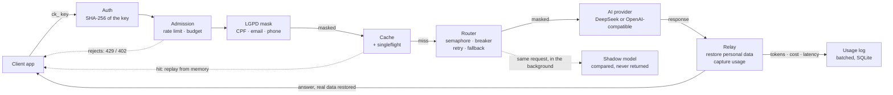
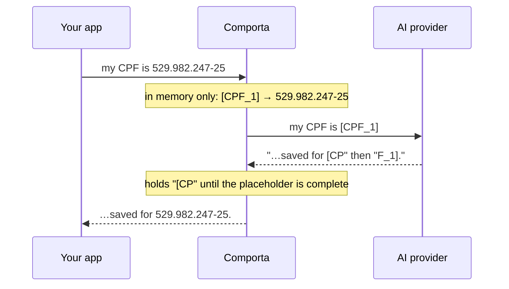

# Comporta: project overview

A gateway that sits between a company's applications and AI providers. It keeps AI spend under control,
survives provider outages, and masks Brazilian personal data before it leaves the company.

*Comporta* is Portuguese for floodgate: it decides what flows through to the provider and what doesn't.

- **Live demo:** [comporta.onrender.com](https://comporta.onrender.com). Sign in with `demo-comporta`; in the
  Playground use the key `ck_demo_comporta`. It runs on a fake provider, so there's no real AI and no cost.
- **Technical details:** [README](../README.md) and [ARCHITECTURE.md](ARCHITECTURE.md).

## The problem

Once a company puts AI into its products, control slips away quickly. Tools like LiteLLM, Portkey, Helicone
and Cloudflare AI Gateway exist for exactly this reason. These are the four things that go wrong first:

- **Keys everywhere.** The provider's API key ends up copied into every app that needs it.
- **Nobody knows the spend.** One buggy app can burn the whole month's budget before anyone notices.
- **Paying twice.** The same question gets sent, and billed, again and again.
- **Data and outages.** When the provider goes down, everything goes down. And customers' CPF, email and
  phone numbers travel to servers outside Brazil.

## What Comporta does

Applications talk to Comporta exactly as they would talk to OpenAI. Only the base URL changes, so any
existing SDK works.

| Capability | What it means |
|---|---|
| A key per app | Each application gets its own `ck_` key, with a request rate and a monthly budget in US$. The real provider key never leaves the server; client keys are stored only as SHA-256 hashes. |
| LGPD masking | CPF and CNPJ (validated by check digit), card numbers (Luhn), email and Brazilian phone numbers are swapped for placeholders before the request leaves, and restored in the answer, including while it streams. |
| Cache + singleflight | An opt-in exact cache, and identical requests that arrive at the same time become a single paid call. |
| Resilience | Per-model concurrency limit, retry with backoff and jitter, a circuit breaker per client and destination, and fallback to the next model, all before the first byte reaches the client. |
| Shadow mode | Sends the same request to a second model in the background and compares latency, cost and size, so you can migrate models without risk to users. |
| Usage and cost | Tokens, cost in micro-dollars, latency and cache hits per client and per model, in a React dashboard embedded in the same binary. |

## Life of a request

Cheap checks run first: authentication and admission happen before any work that costs money. Personal
data is masked before the cache, so neither the cache nor the provider ever sees a real CPF.

## How the LGPD masking works

LGPD is Brazil's data protection law. CPF and CNPJ are the Brazilian taxpayer IDs for people and companies.
Comporta only masks a CPF or CNPJ when its check digits are valid, so random 11-digit numbers are left alone.
The same value always gets the same placeholder within a request, so the model can still refer to it
consistently.

The provider only ever sees `[CPF_1]`. The mapping back to the real value lives in the request's memory and
is never written to logs, cache or the database. In a stream, a placeholder can arrive split across two
chunks, so the restorer holds back the partial piece until it can be replaced. A fuzz test checks that
masking and then restoring always returns the original text.

## Measured, not estimated

Load tests with k6 at 1,000 requests per second for 30 seconds, against a fake provider that always takes
60 ms, with LGPD masking on. The fake provider speaks the same HTTP protocol as DeepSeek, so the tests
exercise the real network code at no cost.

| Result | Context |
|---|---|
| **~1.7 ms** gateway overhead | p95 of 61.7 ms against a 60 ms provider. 1,000 req/s was the test rate, not a measured limit. |
| **99.9%** of paid calls avoided | With 20 repeated questions. Real savings depend on how often apps repeat questions. |
| **98.4%** success while the provider fails half the time | Matches the theory, 1 − (0.5³)²: three attempts on two destinations. The cost is backoff latency (p95 649 ms). |
| **24 MB** Docker image | Distroless, a single binary with the dashboard inside. About 22 MiB of memory under load. |

## Engineering decisions worth talking about

- **The standard library's `net/http`.** The bottleneck is the provider, which takes seconds, not the HTTP
  parser, which takes microseconds. Besides the SQLite driver, only three small libraries: a rate limiter,
  singleflight and a circuit breaker.
- **One OpenAI-compatible client and a fake provider on the same protocol.** DeepSeek and other
  OpenAI-compatible APIs differ only in their base URL, so there is a single client. The fake provider is an
  HTTP server that behaves like DeepSeek, so tests and load tests run through the same network path as
  production.
- **Mask before caching.** The cache key is computed from the already-masked request. Personal data never
  reaches the cache, the logs or the provider.
- **Retry only before the first byte, and inside the circuit breaker.** Once an answer has started streaming
  there's no going back, so retries and fallback happen only before that. The breaker sees only the final
  result of the retries, and a client's own 4xx errors don't open it.
- **Singleflight that survives the leader leaving.** When ten identical requests arrive together, one makes
  the call and the others wait for it. If that first client disconnects, the call keeps going
  (`context.WithoutCancel`), so the other nine still get their answer.
- **A circuit breaker per client and destination.** With a shared breaker, one client sending requests that
  time out could take the provider offline for everyone. Isolated, each client can only trip its own path.
- **Usage written in batches.** Requests drop a usage event onto a buffered channel, and a background writer
  saves them in batches of 500 or every second. If the database falls behind, events are dropped and counted
  rather than slowing the API down.

## Limitations

- Masking works by pattern. It doesn't catch names, addresses or data without a fixed format, and it only
  covers message text, not images or tool-call arguments. It reduces risk; it doesn't guarantee LGPD compliance.
- The budget is a soft cap: it's checked before each call and the real cost is added afterwards, so concurrent
  requests can go slightly over.
- It runs as a single instance. Cache, rate limits and budgets live in memory, and scaling out needs Redis.
- The DeepSeek prices in the config are examples.

## Stack, and learning Go along the way

Go 1.27 (`net/http`, `log/slog`), SQLite without cgo, React 19 with TanStack Query, Recharts and Tailwind
embedded through `go:embed`, a distroless Docker image, k6 for load tests, and a public demo on Render.

I come from TypeScript, React and Python, and built Comporta while learning Go. These mappings helped the most:

| In TypeScript / Node | In Go |
|---|---|
| `AbortController` and `AbortSignal` | `context.Context`, passed to every call that does I/O |
| `p-limit` for concurrency | a buffered channel as a semaphore |
| `Promise.race` with a timeout | `select` over a channel, a timer and `ctx.Done()` |
| an interface declared next to its implementation | a small interface declared where it's used |
| `fast-check` | fuzz tests built into `go test` |

## What's next

- Redis for cache, rate limits and budgets shared across instances.
- Prometheus metrics with labels and OpenTelemetry tracing.
- Deploy on Cloud Run with Secret Manager.
- A hard budget cap that reserves the maximum cost up front, and rate limits by estimated tokens.
